# ARN PW

## Introduction

L'objectif de ce projet est de développer une solution capable de reconnaître cinq types de fruits entiers (non coupés) :

- Les **Pommes**
- Les **Bananes**
- Les **Kiwis**
- Les **Oranges**
- Les **Poires**

Ces fruits ont été choisis pour leur disponibilité commune, leurs caractéristiques visuelles distinctives et leur pertinence pratique dans des applications telles que les cuisines intelligentes ou encore le tri automatique des produits d'épicerie par exemple.

## Problème

Nous avons donc cinq classes : **Pomme**, **Banane**, **Kiwi**, **Orange** et **Poire**. Pour chacune des classes, nous avons collecté 50 images réelles à l'aide de la caméra de notre smartphone. Ces images ont été prises dans des environnements et éclairages variés et sous différents angles afin d'assurer une diversité suffisante pour l'entraînement du modèle. Le graphique ci-dessous illustre la distribution des classes dans notre dataset d'entraînement :

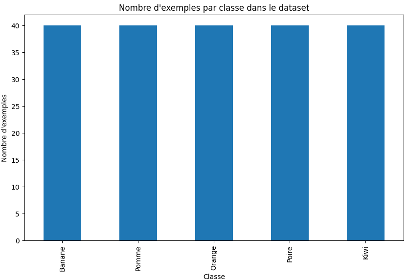

### Diversité intra-classe

Chaque classe présente des variations significatives dues à la nature des fruits et à leur état de maturité. Voici quelques exemples de variations que l'on peut observer :

- **Pommes** : les pommes peuvent varier en couleur (rouge, vert, jaune) et en taille. Elles peuvent également présenter des marques ou des imperfections dues à leur croissance.

- **Bananes** : les bananes peuvent être jaunes, vertes ou brunes, et leur taille peut varier. Elles peuvent également présenter des taches brunes ou des marques de frottement.

- **Kiwis** : les kiwis ont une peau brune, mais leur texture peut varier, allant de lisse à duveteuse. Leur taille peut également différer.

- **Oranges** : les oranges sont généralement orange, mais il existe des variations de taille et de texture. Certaines peuvent être plus lisses, tandis que d'autres peuvent avoir une peau plus rugueuse.

- **Poires** : les poires peuvent être vertes, jaunes ou brunes, et leur forme peut varier considérablement. Elles peuvent également présenter des taches ou des marques dues à leur maturation.

### Similarité inter-classe

Les fruits de différentes classes peuvent présenter des ressemblances visuelles potentiellement ambiguës. Par exemple :

- Les **pommes** et les **poires** peuvent avoir des couleurs et des formes sphériques similaires, ce qui peut rendre leur distinction difficile.

- Les **oranges** et les **pommes** peuvent avoir des teintes et des tailles similaires, en particulier pour les variétés d'oranges plus petites.

- Les **kiwis** et les **pommes** peuvent être confus en raison de leur taille et de leur forme arrondie, sourtout si le kiwi est lisse et si la couleur de la pomme tend vers le brun.

Enfin, toutes les classes peuvent présenter des reflets ou des arrières-plans qui peuvent influencer la perception visuelle, rendant la tâche de classification encore plus complexe.

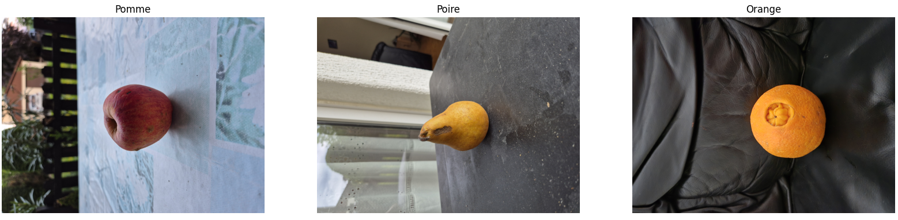

## Préparation des données

### Datasets

Comme mentionné précédemment, nous avons collecté 50 images pour chaque fruit. Nous avons ensuite divisé ces images en deux ensembles :
- **Ensemble d'entraînement (80%)** : 40 images par fruit, soit un total de 200 images.
- **Ensemble de test (20%)** : 10 images par fruit, soit un total de 50 images.

### Prétraitement des images

Les images ont été redimensionnées à une taille uniforme de 224x224 pixels pour garantir la cohérence des entrées du modèle. Pour améliorer la robustesse du modèle, nous avons appliqué diverses techniques d'augmentation des données, notamment le retournement horizontal et vertical aléatoire, la rotation, le zoom, l'ajustement du contraste et la translation. Ces transformations permettent de générer des variations supplémentaires des images d'entraînement, augmentant ainsi la diversité des données et aidant le modèle à mieux généraliser.

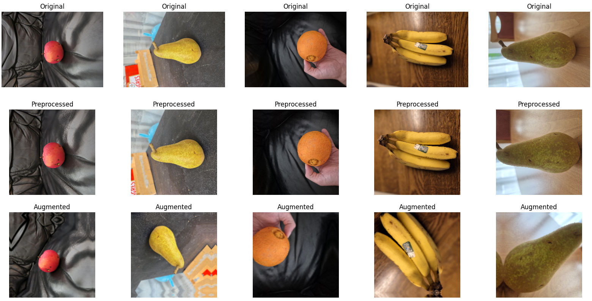

## Création des modèles

Nous avons utilisé des modèles de réseau de neurones convolutifs avec différentes architectures pour trouver celle qui offre le meilleur compromis entre complexité et performance. Nous avons effectué le transfer learning de la même manière pour tous les cas, en utilisant un modèle pré-entraîné sur ImageNet comme point de départ. Nous avons ensuite ajouté des couches personnalisées pour adapter le modèle à notre tâche de classification des fruits.

Pour effectuer le transfer learning, nous gelons toutes les couches du modèle de base **MobileNetV2** et entraînons uniquement les couches que nous avons ajouté. L'avantage d'utiliser du transfer learning est qu'il permet d'avoir accès à un modèle complexe déjà entraîné, avec des couches d'entrées de convolutions qui sont faites pour reconnaître les caractéristiques principales d'une image RGB.

### Premier modèle

Dans ce premier modèle, nous avons ajouté au modèle de base **MobileNetV2** une couche :
- **Dense** avec 64 neurones pour apprendre des caractéristiques de plus haut niveau.
- **ReLU** comme fonction d'activation pour introduire de la non-linéarité.
- **Dense** avec 5 neurones pour la classification finale, utilisant la fonction d'activation **softmax** pour produire des probabilités pour chaque classe de fruit.

```python
def get_model():
    base_model = MobileNetV2(
        input_shape=(224, 224, 3),
        weights='imagenet',
        include_top=False
    )

    layers = base_model.output

    added_layers = [
        # important, we need global average pooling instead of flatten for class activation map later on
        GlobalAveragePooling2D(),
        # TODO: ...
        Dense(64),
        ReLU(),
        Dense(5, activation='softmax')
    ]

    model = Model(inputs=base_model.input, outputs=Sequential(added_layers)(layers))

    # TODO: freeze layers
    for layer in base_model.layers:
        layer.trainable = False

    model.compile(
      optimizer = RMSprop(),
      loss = SparseCategoricalCrossentropy(),
      metrics = ['acc']
    )

    return model
```

- **Nombre d'epochs** : 10
- **Batch size** : 32
- **Nombre de paramètres entraînables** : 82'309

#### Résultats

Les graphiques ci-dessous montrent que le modèle apprend bien mais il présente des signes de surapprentissage après plusieurs époques :

Loss :
- La perte d'entraînement diminue régulièrement, ce qui montre que le modèle apprend bien sur les données d'entraînement.
- La perte de validation diminue également au début, puis stagne voire augmente légèrement vers la fin, indiquant un léger surapprentissage à partir de l’époque 6-7.

Accuracy :
- La précision d'entraînement monte rapidement jusqu’à atteindre presque 1.0, ce qui indique un apprentissage efficace.
- La précision de validation augmente également mais reste plus variable, avec un plateau autour de 0.85-0.9, ce qui est bon mais confirme un écart entre l'entraînement et la validation.

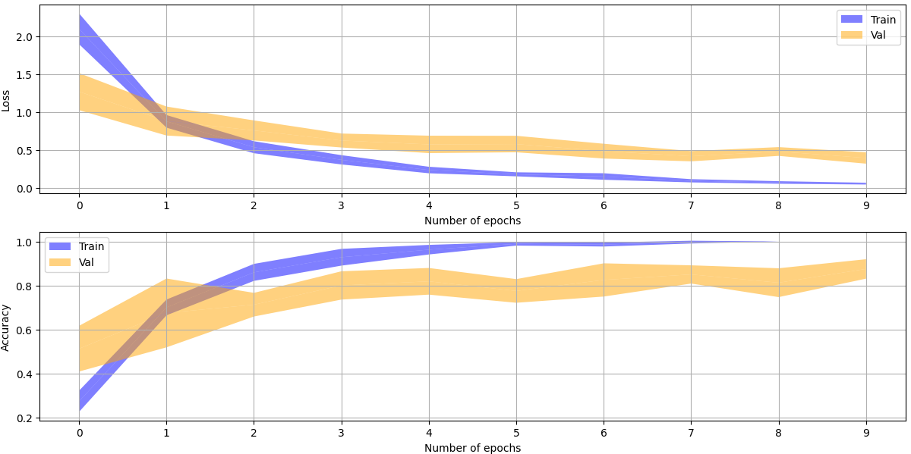

Ci-dessous, nous voyons que le modèle a de la peine à classer le kiwi et l'orange. En revanche, il classe parfaitement la banane, la pomme et la poire.

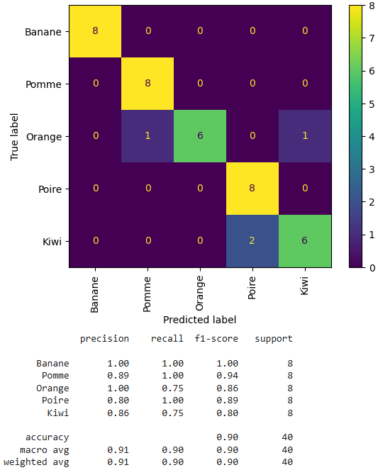

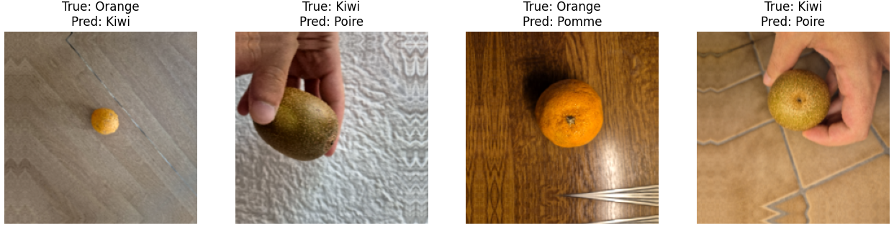

Les zones de chaleur ci-dessous montrent que les régions chaudes sont plutôt bien localisées. Cependant, nous voyons que les images très reculées présentent des zones de chaleur qui sont très étendues, ce qui indique que le modèle a du mal à se concentrer sur les fruits eux-mêmes.

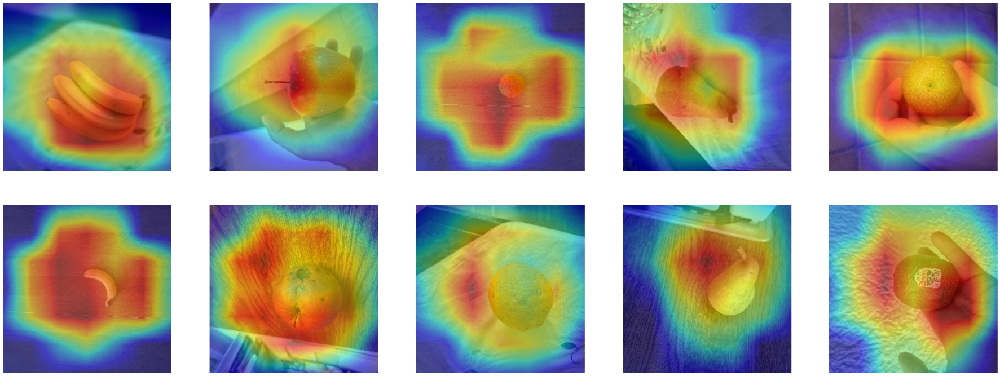

Pour les images mal classées ci-dessous, nous voyons que le modèle a tendance à se concentrer sur des zones qui ne sont pas pertinentes pour la classification notamment sur l'arrière-plan.

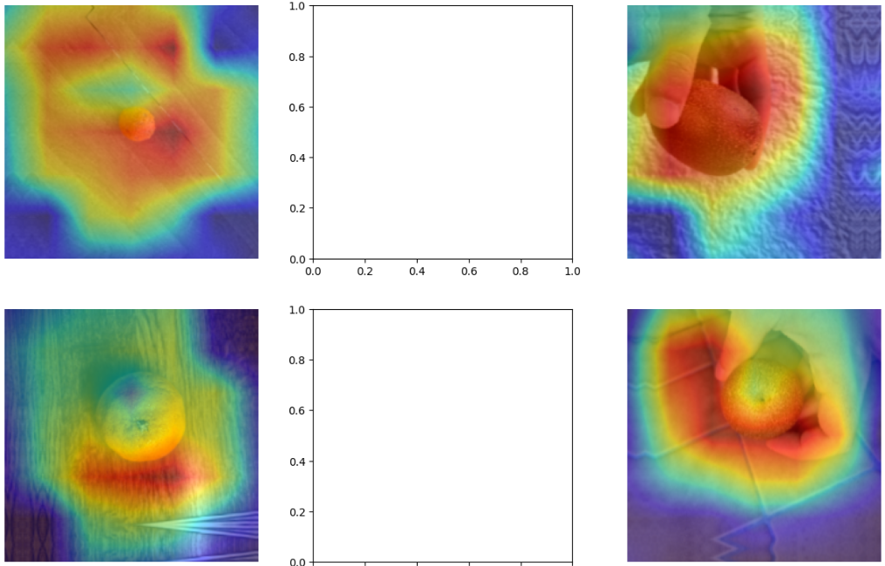

### Deuxième modèle

Dans ce deuxième modèle, nous avons adapté le modèle précédent en ajoutant les couches suivantes pour essayer de réduire le sur-apprentissage :
- **Dense** avec 128 neurones pour apprendre des caractéristiques de plus haut niveau.
- **Batch Normalization** pour stabiliser l'apprentissage et accélérer l'entraînement.
- **ReLU** comme fonction d'activation pour introduire de la non-linéarité.
- **Dropout de 0.5** pour réduire le sur-apprentissage.
- **Dense** avec 5 neurones pour la classification finale, utilisant la fonction d'activation **softmax** pour produire des probabilités pour chaque classe de fruit.

```python
def get_model():
    base_model = MobileNetV2(
        input_shape=(224, 224, 3),
        weights='imagenet',
        include_top=False
    )

    layers = base_model.output

    added_layers = [
        # important, we need global average pooling instead of flatten for class activation map later on
        GlobalAveragePooling2D(),
        # TODO: ...
        Dense(128),
        BatchNormalization(),
        ReLU(),
        Dropout(0.5),
        Dense(5, activation='softmax')
    ]

    model = Model(inputs=base_model.input, outputs=Sequential(added_layers)(layers))

    # TODO: freeze layers
    for layer in base_model.layers:
        layer.trainable = False

    model.compile(
      optimizer = RMSprop(),
      loss = SparseCategoricalCrossentropy(),
      metrics = ['acc']
    )

    return model
```

- **Nombre d'epochs** : 10
- **Batch size** : 32
- **Nombre de paramètres entraînables** : 164'869

#### Résultats

Les graphiques ci-dessous montrent que le modèle apprend très bien sur les données d'entraînement mais il présente des signes clairs de surapprentissage.

Loss :
- La perte d’entraînement chute rapidement et devient très faible, ce qui indique un apprentissage efficace sur les données d'entraînement.
- La perte de validation diminue au début, mais stagne ensuite avec une grande variance, suggérant une difficulté de généralisation.

Accuracy :
- La précision d'entraînement atteint très rapidement des valeurs proches de 1.0 (presque parfaite).
- La précision de validation progresse plus lentement, reste inférieure et se stabilise autour de 0.85-0.9, mais avec une forte variabilité, surtout entre les époques 1 et 4.

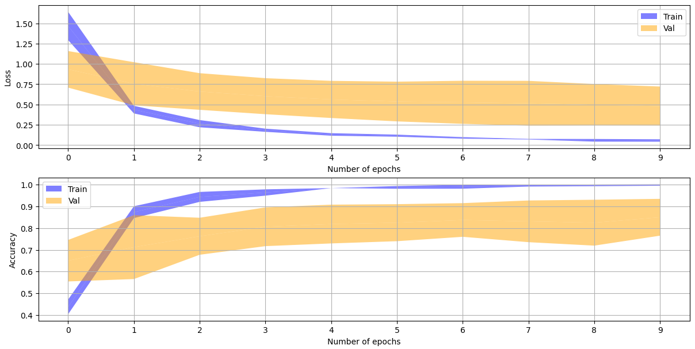

Ci-dessous, nous voyons que le modèle a encore plus de mal qu'avant à classer le kiwi. En revanche, il classe toujours parfaitement la banane, la pomme et la poire.

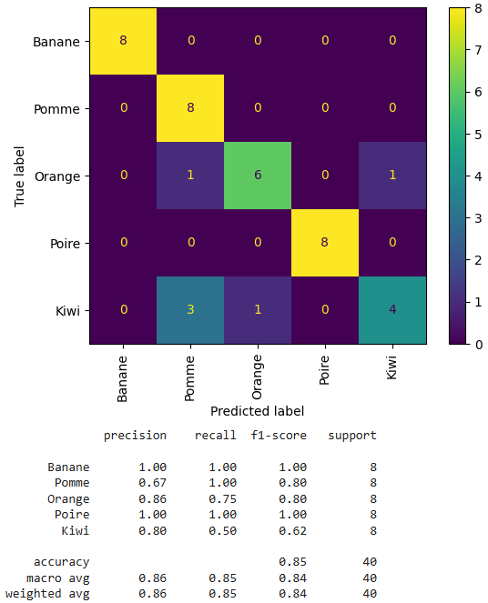

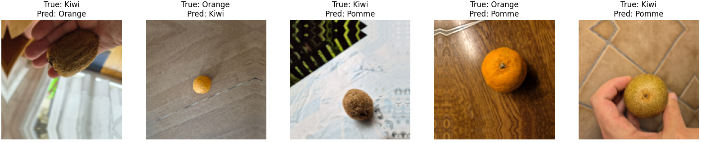

Comme pour le modèle précédent, les zones de chaleur montrent que les régions chaudes sont plutôt bien localisées. Cependant, elles restent très étendues pour les images très reculées et les arrière-plans sont encore une fois très présents.

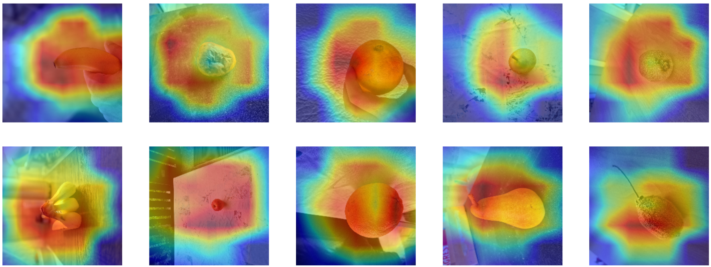

Images mal classées :

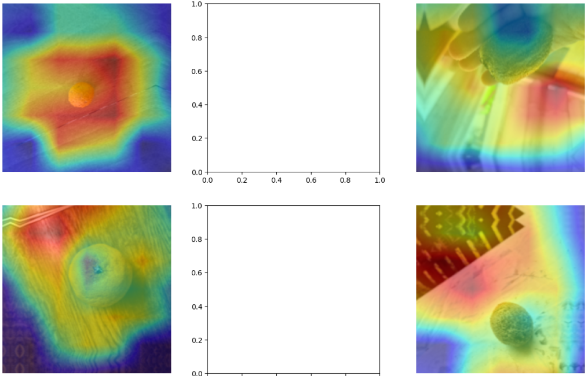

### Troisième modèle

Le deuxième modèle étant moins bon que le premier, nous avons décidé de revenir à une architecture plus simple en gardant quand-même une couche de Dropout. Nous avons donc ajouté les couches suivantes :
- **Dropout de 0.5** pour réduire le sur-apprentissage.
- **Dense** avec 16 neurones pour apprendre des caractéristiques de plus haut niveau.
- **ReLU** comme fonction d'activation pour introduire de la non-linéarité.
- **Dense** avec 5 neurones pour la classification finale, utilisant la fonction d'activation **softmax** pour produire des probabilités pour chaque classe de fruit.

```python
def get_model():
    base_model = MobileNetV2(
        input_shape=(224, 224, 3),
        weights='imagenet',
        include_top=False
    )

    layers = base_model.output

    added_layers = [
        # important, we need global average pooling instead of flatten for class activation map later on
        GlobalAveragePooling2D(),
        # TODO: ...
        Dropout(0.5),
        Dense(16),
        ReLU(),
        Dense(5, activation='softmax')
    ]

    model = Model(inputs=base_model.input, outputs=Sequential(added_layers)(layers))

    # TODO: freeze layers
    for layer in base_model.layers:
        layer.trainable = False

    model.compile(
      optimizer = RMSprop(),
      loss = SparseCategoricalCrossentropy(),
      metrics = ['acc']
    )

    return model
```

- **Nombre d'epochs** : 15
- **Batch size** : 32
- **Nombre de paramètres entraînables** : 20'581

#### Résultats

Les graphiques ci-dessous montrent que le modèle semble bien entraîné et montrent une bonne capacité de généralisation.

Loss :
- La perte diminue progressivement pour les deux ensembles, ce qui indique que le modèle apprend.
- L'écart entre la perte d'entraînement et la perte de validation reste relativement faible, surtout après quelques époques. Cela suggère que le modèle ne sur-apprend pas de manière significative sur les données d'entraînement et généralise bien aux nouvelles données.

Accuracy :
- La précision augmente de manière constante pour les deux ensembles, ce qui est un signe positif de l'apprentissage du modèle.
- La précision de validation suit de près celle de l'entraînement, et même la dépasse légèrement par moments vers la fin de l'entraînement. Cela renforce l'idée que le modèle généralise bien.
- Vers la fin des 14 époques, la précision semble atteindre un plateau ou une convergence, indiquant que des époques supplémentaires pourraient ne pas apporter d'améliorations significatives.

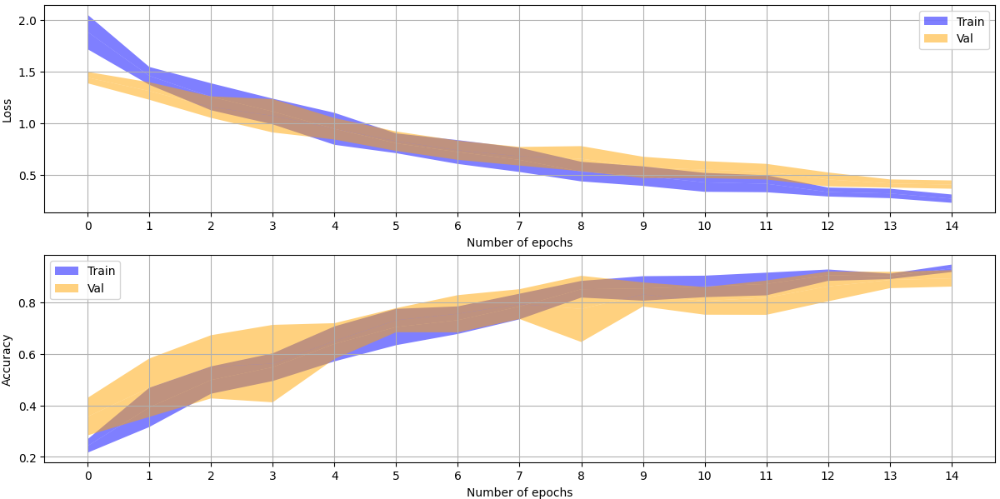

Ci-dessous, nous voyons que comparé au modèle précédent, le modèle se trompe moins avec le kiwi, par contre la poire n'est maintenant plus parfaitement classée. Le reste du classement est similaire au premier modèle.

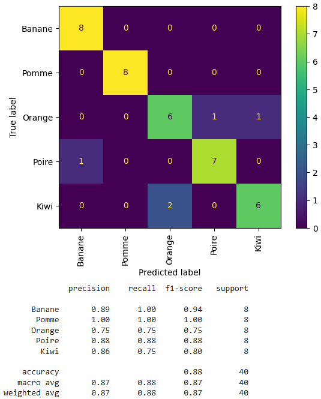

Pour les images mal classées ci-dessous, nous voyons que le modèle se trompe quand le fruit est difficile à distinguer. Par exemple, il confond une orange prise en photo de loin avec un kiwi, ce qui fait que leur taille se ressemble. Ou encore, il confond une poire avec une banane, car la couleur de la poire tend vers le jaune.

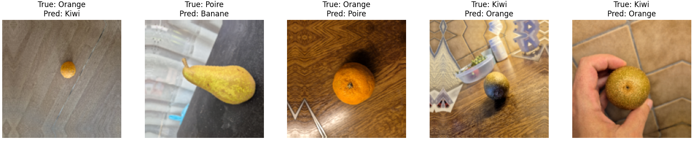

Ci-dessous, les zones de chaleur montrent que les régions chaudes sont plutôt bien localisées. De plus, le modèle ne prend pas en compte l'étiquette sur les fruits comme l'orange ou le kiwi, ce qui signifie qu'il arrive bien à généraliser les caractéristiques des fruits.

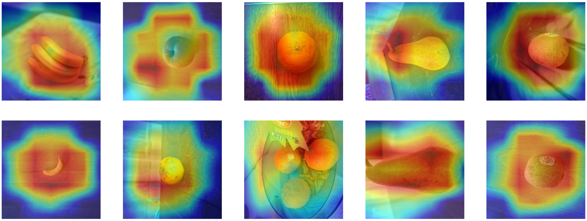

Cependant, lorsque l'arrière-plan n'est pas uniforme, le modèle a tendance à se concentrer sur des zones qui ne sont pas pertinentes pour la classification, comme nous pouvons le voir sur la troisième image ci-dessous.

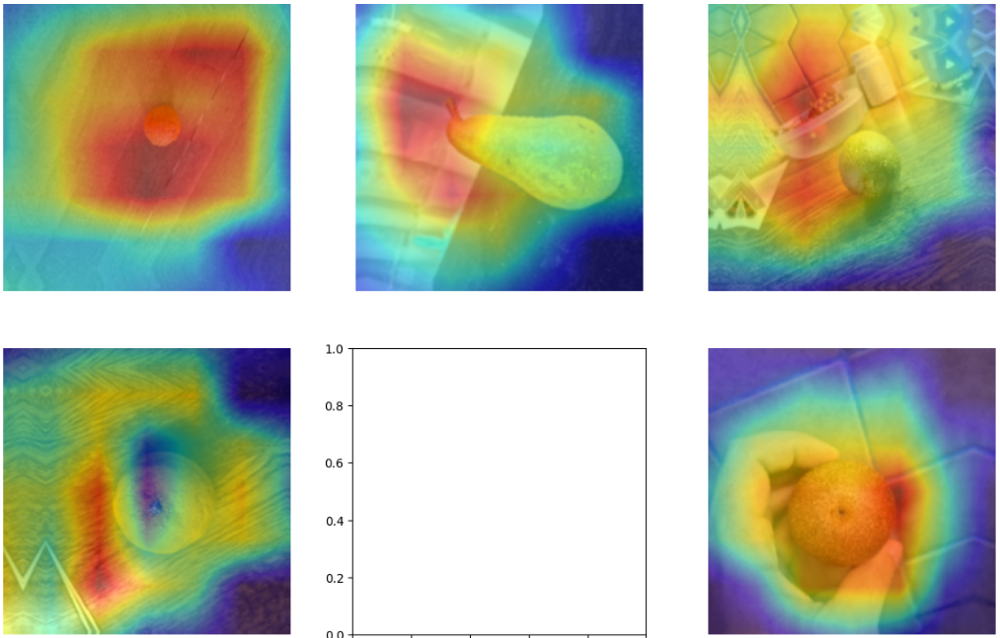

### Choix du modèle final

Après avoir testé les trois modèles, nous avons décidé de choisir le **troisième modèle** comme modèle final. En effet, il présente un bon compromis entre complexité et performance, avec une meilleure généralisation sur les données de validation et moins de sur-apprentissage que les deux premiers modèles.

## Mise en pratique sur un smartphone

Pour la mise en pratique de notre modèle sur un smartphone, nous avons réalisé trois expériences qui consistent à prendre une photo de chaque fruit avec :
- Un fond noir (chaise de bureau)
- Un fond brun (table en bois)
- Un fond blanc (mur)

De plus, pour chaque expérience, nous avons utilisé deux caméras différentes pour voir si la qualité de la caméra influence la reconnaissance des fruits. Nous avons donc utilisé :
- Une caméra USB (de qualité plutôt mauvaise)
- Une caméra de smartphone (de bonne qualité)

### Expérience 1 : Fond noir

Nous voyons que pour les deux caméras, le modèle arrive à reconnaître la banane et la poire, malgré des pourcentages plutôt faibles. Par contre, les autres fruits sont mal reconnus, notamment le kiwi qui n'a même pas un petit pourcentage de reconnaissance.

Pour l'orange, nous voyons que sur la caméra de mauvaise qualité, il n'y a même pas de pourcentage de reconnaissance. En revanche, sur la caméra de bonne qualité, le modèle arrive à reconnaître l'orange avec un pourcentage de 0.25.

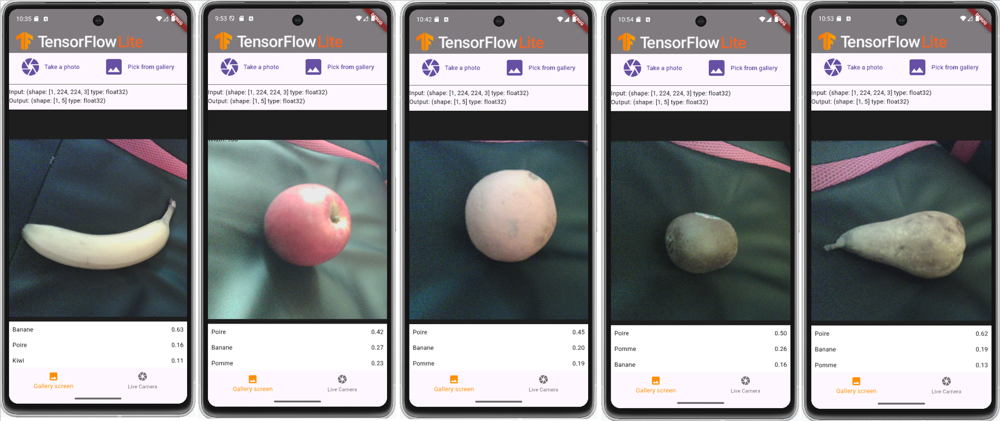

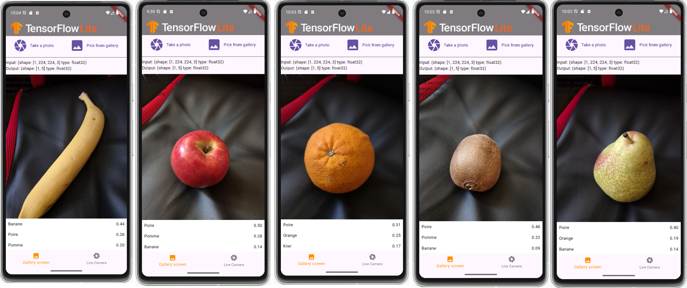

### Expérience 2 : Fond brun

Pour cette expérience, nous voyons que les résultats sont plutôt variés. En effet, sur la caméra de mauvaise qualité, le modèle n'arrive à reconnaître que la poire, alors que sur la caméra de bonne qualité, il n'arrive à reconnaître que la pomme.

Un point surprenant est que la caméra de mauvaise qualité reconnaît mieux la banane que la caméra de bonne qualité, qui donne un pourcentage de reconnaissance extrêmement faible de 0.03.

D'autre part, contrairement à l'expérience précédente, le modèle arrive à reconnaître le kiwi avec un pourcentage de 0.04 sur la caméra de bonne qualité, mais cela reste encore très mauvais.

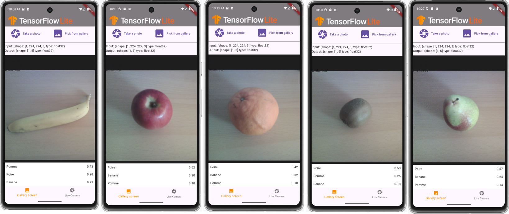

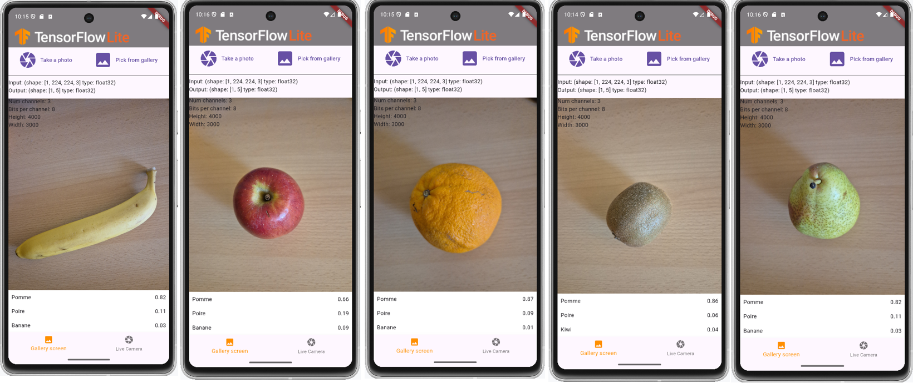

### Expérience 3 : Fond blanc

Pour cette dernière expérience, nous voyons que les deux caméras n'arrivent à reconnaître que la poire, avec un meilleur pourcentage de reconnaissance pour la caméra de mauvaise qualité.

Par ailleurs, comme pour l'expérience précédente, le modèle a vraiment du mal à reconnaître la banane avec la caméra de bonne qualité, contrairement à la caméra de mauvaise qualité qui arrive à reconnaître la banane avec un pourcentage de 0.25.

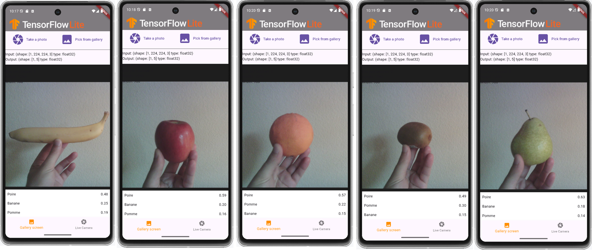

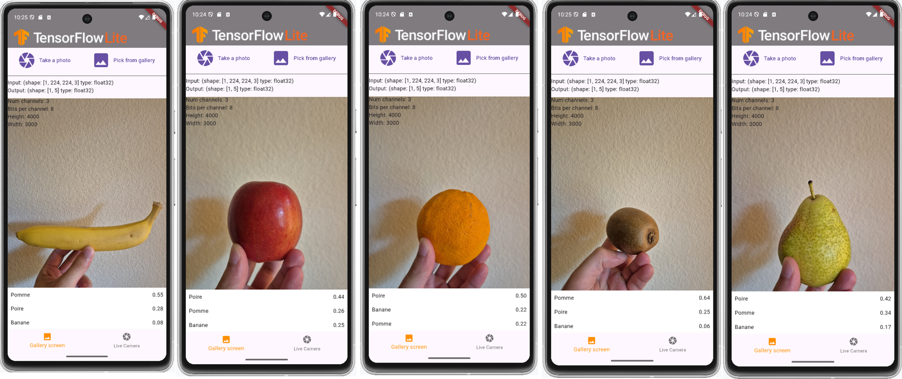

## Conclusion

Ce projet nous a permis de concevoir, entraîner et tester plusieurs modèles de classification d’images pour reconnaître cinq types de fruits entiers à partir de photos : pommes, bananes, kiwis, oranges et poires. En partant d’un modèle de base basé sur MobileNetV2, nous avons expérimenté différentes architectures, en ajustant la complexité des couches ajoutées, afin de trouver le meilleur compromis entre performance, généralisation et simplicité.

Parmi les trois modèles testés, le troisième modèle s’est révélé le plus pertinent. Bien qu’il soit plus simple, il a montré une meilleure capacité de généralisation sur les données de validation, avec moins de sur-apprentissage que les deux autres modèles plus complexes. Il parvient notamment à bien localiser les fruits dans les images et à ignorer les éléments non pertinents comme les étiquettes.

Cependant, les résultats de mise en pratique sur smartphone montrent des limites importantes : les performances du modèle baissent fortement selon la qualité de la caméra et le fond sur lequel le fruit est posé. Certains fruits, notamment le kiwi et l’orange, sont souvent mal classés voire ignorés dans les prédictions. Ce phénomène s’explique probablement par un dataset trop petit, une variabilité visuelle sous-représentée et par une sensibilité accrue du modèle aux conditions d’éclairage et à l’arrière-plan.

En conclusion, ce travail constitue une base fonctionnelle pour la reconnaissance de fruits avec un modèle léger et déployable sur smartphone, mais il met également en évidence les limites d’un petit jeu de données et l'importance de conditions de capture robustes pour des cas d’usage réels.
